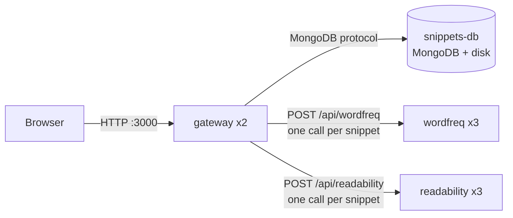

# Snippets — text analysis on Kubernetes

PA2577 Applied Cloud Computing and Big Data, BTH. A microservice application deployed on Kubernetes.

## 1. What the software does

It is a small web app for storing pieces of text and analysing them basically.

The user opens the web page and saves what I chose to call snippets. A snippet is a title plus some text, a paragraph or really anything. The saved snippets are listed on the page and can be deleted.

When the user clicks **"Analyse all snippets"** the application analyses every stored snippet and then shows:

- **Word frequency.** How often each word appears. The counts from all snippets are added together into a **top-10 list of the most used words** .
- **Readability.** A **Flesch reading-ease score** for each snippet, from 0 (hard to read) to 100 (easy) and the average score from all snippets
- **Per-snippet results.** A table with each snippets word count and score and the name of the **worker pod that processed it**. Just to make it vissible that the work is spread


### Who would use it

The intended user is a **content or maybe documentation team** for example: people who write help articles, product descriptions or course material and want to check two things. Is the text easy enough for the people who will read it and are some words overused?
They paste in their texts, and the app tells them which ones are hard to read and which words dominate.

### How it is built

The application consists of four microservices. The **gateway** serves the web page and the public REST API, and stores snippets in a MongoDB database. when someone request a analysis,
it sends every snippe  to two internal worker services. The **wordfreq** worker
counts words. The **readability** worker computes the Flesch score. The gateway then provides the information we want. Every service is its own container image on Docker Hub and Kubernetes Deployment so each one can be scaled independently. The database runs as a StatefulSet with a persistent volume, so the snippets survive pod and cluster restarts.

### Architechture

| Part | Folder | What it does | Talks to | Reachable from outside? |
|---|---|---|---|---|
| **gateway** | `gateway/` | Serves the web page. Has the public REST API. Saves and deletes snippets in the database. For analysis, sends every snippet to both workers and combines the answers. | browser, database, both workers | **Yes** (port 3000) |
| **wordfreq** | `wordfreq/` | Worker. Gets text, returns how many times each word appears. | nobody (only answers) | No |
| **readability** | `readability/` | Worker. Gets text, returns its readability score. | nobody (only answers) | No |
| **snippets-db** | (MongoDB image) | Stores the snippets that survives restarts. | nobody (only answers) | No |



The workers are stateless so they remember nothing between requests. Any copy can answer any reques so you can run multiple of them. The database
is stateful so it owns the data, so there is exactly one of it, with a persistent disk.

### What to pretend

The example texts are vey short unfortunetly so counting the words in one paragrahph is very fast, so a single
worker could analyse everything, and running several replicas is not actually needed at this size.

To see why the architecture makes sense, pretend that each snippet is books like the bible, or that
the team has **millions of snippets** all emails i have ever recieved maybe. Then word counting and readability scoring become the expensive,
CPU-heavy part of the system:
- One analysis sends thousands of texts to the workers at the same time.
- Adding wordfreq or readability replicas makes the analysis finish faster, because the Kubernetes Service spreads the per-snippet requests over all the pods. 
- If one kind of analysis is the slower one, only that worker is scaled up. The other services stay as they are, and the extra cost is limited to the part that needs it.

The gateway does little computing of its own, and the database only has to store the texts.
Neither needs to grow the way the workers do.

## 2. Benefits and challenges

### Benefits

- **Scale only the bottleneck.** Each service has its own Deployment, so you only pay for extra copies of the slow part.
- **Scaling actually helps.** One request per snippet, spread over the worker pods by the Service.
- **Stateless workers.** A crashed worker loses nothing. The DB keeps data on a persistent volume.
- **Portable.** Plain Kubernetes YAML runs on any cloud or on-premises, so there is no vendor lock-in.

### Challenges

| Challenge | Done | Could be done |
|---|---|---|
| More parts to run and debug | Logs per service with `kubectl logs -l app=<name>`, pod names shown in the results | Central logging |
| Database is a single point of failure | Persistent volume | MongoDB replica set |
| Thousands of parallel requests | 5 s timeout, a failed snippet doesn't break the analysis | Concurrency limit or batching |
| Idle replicas cost money | CPU/memory requests and limits | Autoscaling |

### Security

**Done:** only the gateway is exposed (workers and DB are `ClusterIP`). Only the gateway has DB credentials, which are stored in a Kubernetes `Secret`. Type checks stop NoSQL injection,
`textContent` stops XSS, and errors don't leak stack traces.

**Could be done:**
- **No login:** anyone can add or delete snippets → add authenticati
- **No HTTPS:** traffic is plain text → TLS on an Ingress.
- **Password in git:** → `kubectl create secret` or a secret manager.
- **Open internal traffic:** → a `NetworkPolicy` that only lets the gateway reach the workers and the DB.

## 3. How to run

**Kubernetes** (Docker Desktop with Kubernetes enabled):

```sh
kubectl apply -f kubernetes.yaml
kubectl get pods -n snippets         
# open http://localhost:3000 (other clusters: http://<node-ip>:30080)
```

**Logs:** `kubectl logs -n snippets -l app=<gateway|wordfreq|readability> -f`

**Remove everything:** `kubectl delete namespace snippets` 

**Docker Compose** (local development, stop the Kubernetes deployment first since both use port 3000):

```sh
docker compose up --build
```

**New images after a code change:** `sh pushImages.sh v5`, then update the tags in `kubernetes.yaml`.

